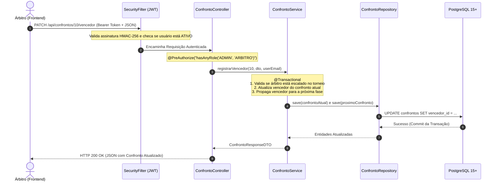

# 📘 FMTTEMA - Guia Arquitetural do Servidor (Backend)

> Manual técnico e didático da API RESTful da **Federação de Muaythai Tradicional do Estado do Maranhão (FMTTEMA)**. Elaborado para estudo, alinhamento técnico da equipe e suporte para a apresentação da disciplina de **Programação Orientada a Objetos (POO)** na **UNDB**.

---

## 🏛️ 1. Visão Geral da Arquitetura

O Backend da FMTTEMA foi projetado seguindo o padrão **Layered Architecture (Arquitetura em Camadas)** sobre o ecossistema **Spring Boot 3** com **Java 21 LTS**. O sistema prioriza transacionalidade ACID, desacoplamento modular, segurança stateless baseada em tokens JWT e isolamento rigoroso de permissões (**RBAC - Role-Based Access Control**).

```
                      ┌─────────────────────────────────────────┐
                      │        Cliente Frontend / SPA           │
                      └────────────────────┬────────────────────┘
                                           │ HTTP REST (JSON / Multipart)
                                           ▼
                      ┌─────────────────────────────────────────┐
                      │    SecurityFilter (JWT HMAC-256)        │
                      └────────────────────┬────────────────────┘
                                           │ Request Autenticada
                                           ▼
                      ┌─────────────────────────────────────────┐
                      │    Controllers REST (@PreAuthorize)     │
                      └────────────────────┬────────────────────┘
                                           │ DTOs (Records Java 21)
                                           ▼
                      ┌─────────────────────────────────────────┐
                      │    Services (@Transactional ACID)       │
                      └────────────────────┬────────────────────┘
                                           │ Entidades JPA / Models
                                           ▼
                      ┌─────────────────────────────────────────┐
                      │    Repositories (Spring Data JPA)       │
                      └────────────────────┬────────────────────┘
                                           │ Queries SQL / Views
                                           ▼
                      ┌─────────────────────────────────────────┐
                      │    Banco de Dados PostgreSQL 15+        │
                      └─────────────────────────────────────────┘
```

---

## 📂 2. Árvore de Diretórios Completa do Backend

```
backend/
├── pom.xml                                  # Gerenciador de dependências Maven e plugins
├── mvnw / mvnw.cmd                          # Maven Wrapper para builds sem dependência de instalação local
├── src/
│   ├── main/
│   │   ├── java/com/fmttema/api/
│   │   │   ├── BackendApplication.java      # Classe de bootstrap que inicializa o Spring Boot
│   │   │   │
│   │   │   ├── config/                      # Configurações de infraestrutura e dados iniciais
│   │   │   │   ├── DataInitializer.java     # Seeder idempotente de dados de teste e views SQL
│   │   │   │   ├── DataSeederConfig.java    # Configurações adicionais de inicialização
│   │   │   │   └── WebConfig.java           # Configurações de CORS e rotas de arquivos estáticos (/uploads/**)
│   │   │   │
│   │   │   ├── controllers/                 # Camada REST que expõe os endpoints HTTP
│   │   │   │   ├── AcademiaController.java
│   │   │   │   ├── ArbitroController.java
│   │   │   │   ├── AtletaController.java
│   │   │   │   ├── AuthController.java
│   │   │   │   ├── ConfrontoController.java
│   │   │   │   ├── DashboardController.java
│   │   │   │   ├── EventoController.java
│   │   │   │   ├── EventoPublicoController.java
│   │   │   │   ├── FinanceiroController.java
│   │   │   │   ├── PatrocinadorController.java
│   │   │   │   ├── RankingPublicoController.java
│   │   │   │   └── UsuarioController.java
│   │   │   │
│   │   │   ├── dto/                         # Data Transfer Objects (Java 21 Records)
│   │   │   │   ├── AcademiaRequestDTO.java
│   │   │   │   ├── AcademiaResponseDTO.java
│   │   │   │   ├── AnuidadeDTO.java
│   │   │   │   ├── ArbitroResponseDTO.java
│   │   │   │   ├── AtletaChaveDTO.java
│   │   │   │   ├── AtletaRankingDTO.java
│   │   │   │   ├── AtletaRequestDTO.java
│   │   │   │   ├── AtletaResponseDTO.java
│   │   │   │   ├── AtualizarCartelDTO.java
│   │   │   │   ├── AtualizarStatusUsuarioDTO.java
│   │   │   │   ├── BaixaAnuidadeRequestDTO.java
│   │   │   │   ├── BaixaAnuidadeResponseDTO.java
│   │   │   │   ├── CategoriaPesoResponseDTO.java
│   │   │   │   ├── ChaveamentoResponseDTO.java
│   │   │   │   ├── ChaveCategoriaDTO.java
│   │   │   │   ├── ConfrontoResponseDTO.java
│   │   │   │   ├── DashboardResumoDTO.java
│   │   │   │   ├── ErroRespostaDTO.java
│   │   │   │   ├── EscalaArbitroRequestDTO.java
│   │   │   │   ├── EscalaArbitroResponseDTO.java
│   │   │   │   ├── EventoPublicoResponseDTO.java
│   │   │   │   ├── EventoRequestDTO.java
│   │   │   │   ├── EventoResponseDTO.java
│   │   │   │   ├── FluxoCaixaResponseDTO.java
│   │   │   │   ├── InscricaoRequestDTO.java
│   │   │   │   ├── InscricaoResponseDTO.java
│   │   │   │   ├── ItemAgregacaoDTO.java
│   │   │   │   ├── LoginRequestDTO.java
│   │   │   │   ├── LoginResponseDTO.java
│   │   │   │   ├── LutaChaveDTO.java
│   │   │   │   ├── PatrocinadorRequestDTO.java
│   │   │   │   ├── PatrocinadorResponseDTO.java
│   │   │   │   ├── RankingPublicoResponseDTO.java
│   │   │   │   ├── RegisterRequestDTO.java
│   │   │   │   ├── RegistrarVencedorDTO.java
│   │   │   │   └── UsuarioResponseDTO.java
│   │   │   │
│   │   │   ├── exceptions/                  # Tratamento global de erros e exceções negociais
│   │   │   │   ├── GlobalExceptionHandler.java
│   │   │   │   └── PagamentoPendenteException.java
│   │   │   │
│   │   │   ├── models/                      # Entidades de Domínio JPA mapeadas para tabelas
│   │   │   │   ├── Academia.java
│   │   │   │   ├── Atleta.java
│   │   │   │   ├── CategoriaPeso.java
│   │   │   │   ├── Confronto.java
│   │   │   │   ├── EscalaArbitro.java
│   │   │   │   ├── Evento.java
│   │   │   │   ├── FluxoCaixa.java
│   │   │   │   ├── Inscricao.java
│   │   │   │   ├── Patrocinador.java
│   │   │   │   ├── PerfilAcesso.java        # Enum: ADMIN, ATLETA, ACADEMIA, ARBITRO, TREINADOR
│   │   │   │   ├── StatusEvento.java        # Enum: AGENDADO, EM_ANDAMENTO, FINALIZADO, CANCELADO
│   │   │   │   ├── StatusInscricao.java     # Enum: CONFIRMADA, CANCELADA
│   │   │   │   ├── StatusPagamento.java     # Enum: PENDENTE, PAGO
│   │   │   │   ├── StatusPresencaArbitro.java # Enum: PENDENTE, CONFIRMADO, RECUSADO
│   │   │   │   ├── StatusUsuario.java       # Enum: ATIVO, PENDENTE, SUSPENSO
│   │   │   │   ├── TipoTransacao.java       # Enum: ENTRADA, SAIDA
│   │   │   │   └── Usuario.java             # Entidade raiz de autenticação (implementa UserDetails)
│   │   │   │
│   │   │   ├── repositories/                # Camada de Persistência (Spring Data JPA)
│   │   │   │   ├── AcademiaRepository.java
│   │   │   │   ├── AtletaRepository.java
│   │   │   │   ├── CategoriaPesoRepository.java
│   │   │   │   ├── ConfrontoRepository.java
│   │   │   │   ├── EscalaArbitroRepository.java
│   │   │   │   ├── EventoRepository.java
│   │   │   │   ├── FluxoCaixaRepository.java
│   │   │   │   ├── InscricaoRepository.java
│   │   │   │   ├── PatrocinadorRepository.java
│   │   │   │   └── UsuarioRepository.java
│   │   │   │
│   │   │   ├── security/                    # Configurações de segurança, filtros e JWT
│   │   │   │   ├── AutenticacaoService.java # Integração com UserDetailsService do Spring
│   │   │   │   ├── SecurityConfig.java      # Configuração de rotas, CSRF, Session e CORS
│   │   │   │   ├── SecurityFilter.java      # Interceptador que decodifica e valida o JWT
│   │   │   │   └── TokenService.java        # Emissor e verificador de tokens HMAC-256
│   │   │   │
│   │   │   └── services/                    # Camada com as regras de negócio puras
│   │   │       ├── AtletaService.java
│   │   │       ├── ConfrontoService.java
│   │   │       ├── DashboardService.java
│   │   │       ├── EscalaArbitroService.java
│   │   │       ├── EventoService.java
│   │   │       ├── FileUploadService.java
│   │   │       ├── FinanceiroService.java
│   │   │       ├── GeradorChavesService.java
│   │   │       ├── InscricaoService.java
│   │   │       ├── PatrocinadorService.java
│   │   │       ├── RankingService.java
│   │   │       └── UsuarioService.java
│   │   │
│   │   └── resources/
│   │       ├── application.properties       # Configurações de banco, JWT e variáveis de ambiente
│   │       └── static/                      # Arquivos estáticos (se houver)
│   └── test/                                # Testes automatizados unitários e de integração
```

---

## 🧩 3. Catálogo Detalhado de Classes e Componentes

### 3.1. Pacote `config`
- **`BackendApplication.java`**: Ponto de partida (`main`) anotado com `@SpringBootApplication`. Dispara o container de IoC do Spring, inicializa o Tomcat embutido e configura o scan de componentes.
- **`DataInitializer.java`**: Implementa `CommandLineRunner`. É executado assim que a aplicação sobe. Cria o usuário administrador padrão (`admin@fmttema.com`), categorias de peso oficiais, 10 atletas realistas com cartel completo, patrocinadores e as **Views SQL** de ranking. É idempotente (não duplica dados se já existirem).
- **`DataSeederConfig.java`**: Classe de apoio para inicializações condicionais de ambiente de desenvolvimento.
- **`WebConfig.java`**: Implementa `WebMvcConfigurer`. Configura CORS globalmente e mapeia o caminho `/uploads/**` para o diretório físico no servidor, permitindo que o navegador acesse os comprovantes e logomarcas enviados.

---

### 3.2. Pacote `models` (Entidades e Enums)
As entidades representam as tabelas do banco de dados mapeadas via **Hibernate/JPA**.
- **`Usuario.java`**: Classe central de identidade. Implementa `UserDetails` do Spring Security. Armazena e-mail, senha criptografada em BCrypt e papel de acesso (`PerfilAcesso`). Possui `@JsonProperty(access = JsonProperty.Access.WRITE_ONLY)` na senha para que o hash nunca seja serializado em JSON de resposta.
- **`Atleta.java`**: Dados federativos do lutador: nome, apelido, CPF, data de nascimento, peso, categoria de peso, graduação de Kruang, histórico de lutas (vitórias, derrotas, empates), status da anuidade e vínculo opcional com `Academia` e `Usuario`.
- **`Academia.java`**: Dados da agremiação credenciada: nome, CNPJ, telefone, cidade, responsável e lista de atletas vinculados (`@OneToMany`).
- **`CategoriaPeso.java`**: Tabela de domínio das categorias oficiais de Muaythai (ex: Peso-Mosca até 51.0kg, Peso-Pesado até 91.0kg).
- **`Evento.java`**: Torneios e campeonatos estaduais. Possui nome, data, local, status, cartaz, link de ingressos e categorias contempladas (`@ManyToMany`).
- **`Inscricao.java`**: Entidade associativa que conecta um `Atleta` a um `Evento` em uma determinada `CategoriaPeso`.
- **`Confronto.java`**: Representa uma luta em uma chave eliminatória. Possui referências para `Atleta` (Corner Vermelho e Corner Azul), fase (ex: Quartas, Semifinal, Final), ordem da luta, vencedor e o árbitro central responsável.
- **`EscalaArbitro.java`**: Registra a designação oficial de um árbitro para trabalhar em um evento, com status de confirmação (`PENDENTE`, `CONFIRMADO`, `RECUSADO`).
- **`FluxoCaixa.java`**: Livro-caixa financeiro contábil. Registra todas as entradas (baixa de anuidade de atletas/academias) com valor, autor da baixa, data/hora e caminho do comprovante.
- **`Patrocinador.java`**: Entidade comercial que armazena os parceiros oficiais da federação, link de redirecionamento, nível de patrocínio e URL da logomarca.

---

### 3.3. Pacote `dto` (Data Transfer Objects)
Todos os DTOs do projeto foram implementados utilizando **Java 21 `record`**, trazendo imutabilidade nativa e eliminando boilerplate.
- **Por que usamos DTOs?**
  1. **Segurança (Mass Assignment):** Impede que um usuário mal-intencionado injete campos restritos (como mudar seu perfil para `ADMIN` diretamente no JSON).
  2. **Controle de Visualização (LGPD / PII):** Permite enviar apenas dados públicos em rankings, sem expor CPF, telefone ou senhas.
  3. **Desacoplamento do Banco:** Se uma coluna do banco mudar de nome, a assinatura da API externa continua idêntica.
- **Destaques:**
  - `ArbitroResponseDTO`: Expõe id, nome, e-mail e status do árbitro **sem o hash BCrypt**.
  - `BaixaAnuidadeRequestDTO`: Valida valor, tipo de beneficiário e comprovante obrigatório.
  - `ErroRespostaDTO`: Formato padronizado de erro RFC 7807 (timestamp, status, erro, mensagem, path, lista de validações).
  - `ChaveamentoResponseDTO` & `LutaChaveDTO`: Estrutura hierárquica para desenhar a árvore do torneio no frontend.

---

### 3.4. Pacote `repositories`
Interfaces que herdam de `JpaRepository<T, ID>`, aproveitando consultas automáticas por convenção e `@Query` em JPQL ou SQL Nativo:
- **`AtletaRepository`**: Busca por CPF, busca por e-mail do usuário vinculado (`findByUsuarioEmail`), contagem e verificações de existência.
- **`AcademiaRepository`**: Busca por e-mail do usuário vinculado (`findByUsuarioEmail`).
- **`EventoRepository`**: Busca eventos ativos para a data atual via consulta JPQL customizada.
- **`ConfrontoRepository`**: Busca todos os confrontos de um evento ordenados por fase e ordem de chave.
- **`EscalaArbitroRepository`**: Valida se um árbitro está formalmente escalado em um evento (`existsByArbitroIdAndEventoId`).
- **`FluxoCaixaRepository`**: Lista o extrato contábil ordenado decrescentemente por data/hora.

---

### 3.5. Pacote `services` (Regras de Negócio)
- **`GeradorChavesService.java`**: Contém o algoritmo proprietário de chaveamento eliminatório com a **Regra do *"Bye"*** (detalhado na seção 5).
- **`InscricaoService.java`**: Valida se o atleta está com anuidade em dia (`PAGO`), se seu peso é compatível com a categoria do torneio e protege contra ataques **IDOR** (Atleta só inscreve a si mesmo; Treinador só inscreve da sua agremiação).
- **`FinanceiroService.java`**: Realiza a baixa manual de anuidades em transação atômica (`@Transactional`), criando o lançamento no `FluxoCaixa` e atualizando o status do atleta/academia para `PAGO`. Oferece upload binário de recibos.
- **`FileUploadService.java`**: Gerencia o salvamento de arquivos físicos (PDFs, PNG, JPG, WEBP) nas pastas `uploads/comprovantes` e `uploads/patrocinadores`, sanitizando nomes com UUID.
- **`EscalaArbitroService.java`**: Valida se o árbitro convocado possui licença vigente (`dataValidadeLicenca >= evento.getData()`) e status `ATIVO`.
- **`ConfrontoService.java`**: Registra o vencedor da luta na súmula interativa, avança o atleta vitorioso automaticamente para o próximo confronto da árvore e valida se o árbitro que está lançando a nota foi formalmente escalado para o evento.
- **`RankingService.java`**: Executa consultas nativas de alta performance nas views SQL `vw_ranking_volume` e `vw_ranking_eficiencia`.

---

### 3.6. Pacote `security`
- **`TokenService.java`**: Utiliza a biblioteca Auth0 Java JWT para assinar e validar tokens HMAC-256 com secret configurável e expiração de 8 horas.
- **`SecurityFilter.java`**: Filtro que estende `OncePerRequestFilter`. Em cada requisição HTTP, extrai o cabeçalho `Authorization: Bearer <token>`, valida o token e popula o `SecurityContextHolder` do Spring caso o usuário esteja `ATIVO`.
- **`SecurityConfig.java`**: Configura o `SecurityFilterChain`. Desabilita CSRF (por ser API stateless), define sessão como `STATELESS`, configura permissões granulares por rota e método HTTP, e define manipuladores JSON customizados para `401 Unauthorized` e `403 Forbidden`.

---

### 3.7. Pacote `exceptions`
- **`GlobalExceptionHandler.java`**: Classe anotada com `@RestControllerAdvice` que intercepta qualquer erro não capturado nos controladores:
  - `EntityNotFoundException` ➔ Retorna `404 Not Found` em JSON.
  - `MethodArgumentNotValidException` (`@Valid`) ➔ Retorna `400 Bad Request` com mapa detalhado de campo e mensagem.
  - `AccessDeniedException` ➔ Retorna `403 Forbidden` padronizado.
  - `PagamentoPendenteException` / `IllegalArgumentException` ➔ Retorna `400 Bad Request`.
  - `Exception` genérica ➔ Retorna `500 Internal Server Error` sem expor stack trace ao cliente.

---

## 🏛️ 4. Pilares de POO Aplicados no Código

| Pilar de POO | Onde e Como foi Aplicado no Projeto |
| :--- | :--- |
| **Encapsulamento** | Todos os atributos das entidades são `private`. O acesso é feito via métodos seletores (getters/setters). No `Usuario.java`, o campo `senha` possui anotação `WRITE_ONLY`, impedindo que o hash BCrypt seja lido. Nos DTOs (`record`), os atributos são imutáveis (`final`). |
| **Abstração** | A interface `JpaRepository` abstrai todo o dialeto SQL e JDBC do PostgreSQL. Os Controllers conversam com interfaces e contratos de Services sem conhecer detalhes de banco de dados ou sistemas de arquivos. |
| **Herança** | `SecurityFilter` herda de `OncePerRequestFilter`. `PagamentoPendenteException` herda de `RuntimeException`. `Usuario` herda e implementa as interfaces do ecossistema Spring. |
| **Polimorfismo** | A classe `Usuario` implementa a interface `UserDetails` do Spring Security, substituindo métodos como `getAuthorities()`, `getPassword()` e `isEnabled()` para conectar o domínio próprio ao motor de segurança do Spring. |
| **Inversão de Controle & Injeção de Dependências** | Nenhum Service ou Controller instancia outro objeto com `new`. Todas as dependências são injetadas via construtor gerenciado pelo Spring Container (`@Service`, `@RestController`), promovendo acoplamento fraco e facilidade de testes. |

---

## 🔄 5. Fluxo de Vida Completo de uma Requisição

Abaixo está o ciclo de vida de uma requisição típica no sistema (ex: Árbitro lançando a súmula de uma luta em `PATCH /api/confrontos/10/vencedor`):



---

## ⚙️ 6. Regras de Negócio Críticas Documentadas

### 6.1. O Algoritmo de Chaveamento e a Regra do *"Bye"* (`GeradorChavesService`)
No Muaythai, o número de atletas inscritos em uma categoria frequentemente não é uma potência perfeita de 2 (2, 4, 8, 16, 32).
- **Como funciona o cálculo de Byes:**
  $$\text{Potência Superior} = 2^{\lceil \log_2(N) \rceil}$$
  $$\text{Número de Byes} = \text{Potência Superior} - N$$
  *Exemplo:* Para 6 inscritos, a potência superior é 8. O número de Byes será $8 - 6 = 2$.
- **Aplicação Prática:**
  Dois atletas recebem o status de "Bye" na primeira rodada (Quartas de Final) e avançam diretamente para a Semifinal sem lutar, aguardando os vencedores das outras duas lutas. O algoritmo garante balanceamento estatístico sem confrontos vazios.

### 6.2. Proteção Anti-IDOR (Insecure Direct Object Reference)
Em `InscricaoService.java`, se um usuário logado como `ATLETA` tentar enviar o `atletaId` de um terceiro no payload da requisição, o método extrai o e-mail do token JWT e verifica:
```java
if (usuario.getPerfil() == PerfilAcesso.ATLETA) {
    if (!atleta.getUsuario().getEmail().equalsIgnoreCase(userEmail)) {
        throw new AccessDeniedException("Você só tem permissão para inscrever a si próprio.");
    }
}
```

### 6.3. Baixa Financeira Atômica e Fluxo de Caixa (`FinanceiroService`)
A confirmação de anuidade (`realizarBaixaManual`) usa estritamente `@Transactional(rollbackFor = Exception.class)`. Se a escrita no `FluxoCaixa` falhar por qualquer motivo após alterar o status do atleta para `PAGO`, toda a operação sofre Rollback imediato no PostgreSQL, evitando inconformidades fiscais.

### 6.4. Views SQL de Ranking de Alta Performance
Para não sobrecarregar a CPU do servidor Java calculando aproveitamento percentual de dezenas de atletas a cada requisição, foram criadas duas views materializadas no banco de dados:
1. `vw_ranking_volume`: Ordena prioritariamente por vitórias brutas.
2. `vw_ranking_eficiencia`: Filtra atletas com ao menos 3 lutas e calcula:
   $$\text{Aproveitamento (\%)} = \left(\frac{\text{Vitórias}}{\text{Total de Lutas}}\right) \times 100$$

---

## ❓ 7. Perguntas e Respostas Rápidas (FAQ da Banca de POO)

### P1: Por que usamos DTOs em vez de expor as entidades JPA diretamente nos Controllers?
> **Resposta:** Por três razões fundamentais: **Segurança** (impede Mass Assignment, evitando que um usuário envie campos maliciosos no JSON), **Privacidade/LGPD** (não serializamos campos sensíveis como hashes BCrypt, senhas ou CPFs para quem não deve ver) e **Desacoplamento** (mudanças no esquema do banco não quebram o contrato com o frontend).

### P2: Como o Spring Security sabe quem é o usuário em cada requisição?
> **Resposta:** O cliente envia o token JWT no cabeçalho `Authorization: Bearer <token>`. O nosso `SecurityFilter` intercepta a requisição antes de chegar ao Controller, decodifica a assinatura criptográfica HMAC-256 e injeta o usuário autenticado no `SecurityContextHolder`. Dessa forma, annotations como `@PreAuthorize("hasRole('ADMIN')")` conseguem validar permissões de imediato.

### P3: O que acontece se ocorrer uma falha durante o cadastro de um atleta com usuário?
> **Resposta:** Como o método em `AtletaService` é anotado com `@Transactional(rollbackFor = Exception.class)`, se a criação do `Usuario` der certo mas a do `Atleta` lançar uma exceção de validação, o Spring desfaz automaticamente o insert do usuário. Não ficam registros órfãos no banco de dados.

### P4: Como o sistema impede que um árbitro lance resultado em um evento qualquer?
> **Resposta:** Em `ConfrontoService.java`, antes de aceitar a pontuação da súmula, o sistema faz uma consulta em `EscalaArbitroRepository` verificando se existe um registro oficial com o ID do árbitro e o ID do evento correspondente àquele confronto. Se não houver, uma `AccessDeniedException` é lançada.

### P5: Como o Hibernate cria e mantém as tabelas do banco?
> **Resposta:** Configuramos no `application.properties` a propriedade `spring.jpa.hibernate.ddl-auto=update`. Com base nas anotações `@Entity`, `@Table`, `@Column` e `@JoinColumn`, o Hibernate lê os metadados das classes Java e gera automaticamente os comandos DDL (`CREATE TABLE`, `ALTER TABLE`) no PostgreSQL.
