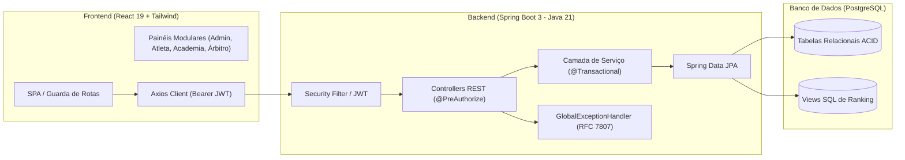

# 🥊 FMTTEMA - Sistema de Gestão Esportiva e Competições

> Plataforma web oficial da **Federação de Muaythai Tradicional do Estado do Maranhão (FMTTEMA)**. O sistema automatiza a gestão federativa estadual: filiação de atletas e academias, controle de anuidades, geração algorítmica de chaves de luta (com regra do *"Bye"*), súmula interativa de confrontos, escalas de arbitragem, vitrine pública de rankings e eventos, e governança administrativa completa via RBAC.

[](https://adoptium.net/)
[](https://spring.io/projects/spring-boot)
[](https://spring.io/projects/spring-security)
[](https://www.postgresql.org/)
[](https://react.dev/)
[](https://tailwindcss.com/)
[](https://vitejs.dev/)

---

## 🎓 Contexto Acadêmico
Projeto desenvolvido como produto avaliativo (PJBL) para a disciplina de **Programação Orientada a Objetos (POO)** do curso de Análise e Desenvolvimento de Sistemas da **Unidade de Ensino Superior Dom Bosco (UNDB)**.

---

## 🏛️ Identidade Visual e Arquitetura

O sistema adota o padrão **Monorepo Modular** com segregação estrita de responsabilidades:
- **`backend/`**: API RESTful robusta desenvolvida em Java 21 com Spring Boot 3, Hibernate/JPA, tratamento global de exceções RFC 7807 e segurança JWT.
- **`frontend/`**: Single Page Application (SPA) reativa desenvolvida em React 19 + Vite, estilizada com a paleta oficial do Maranhão (Azul Marinho `#002868`, Vermelho `#D91C22` e Branco) via Tailwind CSS.



---

## 🔐 Matriz de Perfis de Acesso (RBAC Ponta a Ponta)

O sistema conta com isolamento e controle de permissões em todas as camadas (Spring Security, Controllers e Sidebar/Rotas no Frontend):

| Perfil | Escopo e Funcionalidades Disponíveis |
| :--- | :--- |
| **`ADMIN`** | Acesso irrestrito: Homologação de pendências cadastrais, gestão financeira completa com baixa manual, aprovação de anuidades, geração e persistência de chaves de torneios, escala de árbitros, CRUD de parceiros e relatórios analíticos executivos. |
| **`ATLETA`** | Portal individual: Consulta de perfil esportivo e cartel de lutas (`/api/atletas/me`), upload de comprovante de anuidade federativa, inscrição em torneios com validação preventiva de peso e categoria. Bloqueado de visualizar dados sensíveis (PII/LGPD) de atletas concorrentes. |
| **`ACADEMIA`** | Portal da agremiação filiada: Consulta cadastral (`/api/academias/me`), visualização e envio de comprovante da anuidade da academia, gestão exclusiva do plantel de alunos vinculados (`/api/atletas/minha-equipe`). |
| **`ARBITRO`** | Portal de arbitragem: Painel de convocações oficiais (`/api/arbitros/me/escalas`), confirmação/recusa de presença e lançamento oficial de súmulas interativas com avanço de vencedor na árvore do torneio (apenas para eventos em que foi formalmente escalado). |
| **`TREINADOR`** | Comissão técnica: Gestão e atualização do cartel esportivo (vitórias, derrotas, empates, graduação Kruang) exclusivamente dos atletas de sua respectiva academia. |

---

## ⚙️ Módulos e Funcionalidades Principais

### 1. Autenticação e Segurança Forte
- Autenticação stateless via **JSON Web Tokens (JWT)** com algoritmo HMAC-256.
- Autocadastro público restrito a Atletas e Academias (criação de `ADMIN` ou `ARBITRO` via endpoint público é bloqueada com HTTP 403).
- Validação de status ativo no login (`Usuario.isEnabled()` checa `status == StatusUsuario.ATIVO`).
- Anonimização de hashes BCrypt (senhas nunca são expostas em respostas da API via `@JsonProperty(access = WRITE_ONLY)` e DTOs dedicados).

### 2. Logística de Torneios & Chaves Automáticas
- Cadastro de eventos com múltiplas categorias oficiais de Muaythai (Peso-Mosca até Peso-Super-Pesado).
- **Algoritmo de Chaveamento FMTTEMA:** Cruzamento automático em potências de 2 com aplicação da **Regra do *"Bye"*** (passagem direta para a próxima fase quando o número de inscritos for ímpar ou não-potência).
- **Súmula Interativa e Árvore Visual:** Renderização visual da árvore eliminatória (Quartas, Semifinal e Final) com registro atômico de vencedor (`PATCH /api/confrontos/{id}/vencedor`) e propagação para as lutas subsequentes.
- **UX Preventiva em Inscrições:** A interface destaca visualmente a categoria compatível com o peso do atleta e desabilita o botão antes do clique caso o peso exceda o limite, prevenindo erros 400.

### 3. Gestão Financeira e Upload Real de Comprovantes
- Controle de anuidade individual de atletas (R$ 150,00) e academias (R$ 300,00).
- **Upload Binário Real (Multipart):** Suporte nativo a envio de comprovantes em PDF e imagens (PNG, JPG, WEBP) armazenados no servidor com URL pública.
- Atletas e Agremiações podem anexar seus comprovantes diretamente no painel.
- Administradores realizam a **Baixa Manual com lançamento atômico no Fluxo de Caixa** (`@Transactional`), com visualizador modal integrado de recibos.

### 4. Escalas de Arbitragem
- Convocação de árbitros pela diretoria executiva com validação obrigatória de licença vigente (`dataValidadeLicenca >= evento.getData()`) e status ativo.
- Interface com modais elegantes em Tailwind (sem diálogos nativos `alert`/`confirm`).

### 5. Vitrine Pública e Rankings Estaduais
- Landing page institucional aberta ao público com calendário de torneios e link de ingressos.
- **Views SQL de Alta Performance:** Rankings estaduais calculados diretamente no banco de dados:
  - *Ranking por Volume:* Ordenado por vitórias absolutas e total de lutas.
  - *Ranking por Eficiência:* Atletas com aproveitamento percentual (\%) superior (mínimo de 3 lutas).
- Vitrine de parceiros e patrocinadores comerciais da federação.

### 6. Tratamento Global de Exceções
- Respostas padronizadas em formato JSON (RFC 7807) gerenciadas por [`GlobalExceptionHandler.java`](backend/src/main/java/com/fmttema/api/exceptions/GlobalExceptionHandler.java):
  - `400 Bad Request` com mapa de erros de Bean Validation (`@Valid`).
  - `403 Forbidden` com mensagens contextuais de permissão.
  - `404 Not Found` para entidades inexistentes.
  - `500 Internal Error` para erros inesperados protegidos.

---

## 🛠️ Tecnologias Utilizadas

### Backend
- **Java 21 (LTS)**
- **Spring Boot 3.4.x** (Spring Web, Spring Security, Spring Data JPA, Spring Validation)
- **Java JWT (Auth0) 4.4.0**
- **PostgreSQL Driver**
- **Hibernate ORM**
- **Maven**

### Frontend
- **React 19.x** + **Vite 8.x**
- **Tailwind CSS 3.4.x**
- **React Router Dom 7.x**
- **Axios** (com interceptors para injeção de token e logout automático em 401)
- **Lucide React** (iconografia institucional)
- **Recharts** (gráficos e métricas analíticas)

---

## 🚀 Como Executar o Projeto Localmente

### Pré-requisitos
Certifique-se de ter instalado em sua máquina:
- [JDK 21](https://adoptium.net/) (Defina a variável `JAVA_HOME`)
- [Node.js 18+](https://nodejs.org/) e npm
- [PostgreSQL 15+](https://www.postgresql.org/)
- Git

---

### 1. Clonar o Repositório
```bash
git clone https://github.com/Pedrocah4/POO_FMTTEMA.git
cd POO_FMTTEMA
```

---

### 2. Configurar o Banco de Dados (PostgreSQL)
Crie um banco de dados vazio no PostgreSQL chamado `fmttema_db`:
```sql
CREATE DATABASE fmttema_db;
```

As credenciais padrão do Spring Boot são:
- **URL:** `jdbc:postgresql://localhost:5432/fmttema_db`
- **Usuário:** `postgres`
- **Senha:** `1234`

> Caso sua senha ou usuário local sejam diferentes, você pode alterá-los em [`backend/src/main/resources/application.properties`](backend/src/main/resources/application.properties) ou definir variáveis de ambiente:
> ```bash
> export DB_USERNAME=seu_usuario
> export DB_PASSWORD=sua_senha
> ```

---

### 3. Executar o Backend (Spring Boot)
Abra um terminal na pasta raiz do projeto:
```bash
cd backend

# No Windows (PowerShell):
.\mvnw.cmd spring-boot:run

# No Linux/macOS:
./mvnw spring-boot:run
```
A API iniciará na porta **`8080`** (`http://localhost:8080`).

> 💡 **Data Seeding Automático:** Ao inicializar pela primeira vez, a classe `DataInitializer` criará automaticamente as categorias oficiais, 10 atletas realistas com cartel, academias, eventos, árbitros, patrocinadores e as Views SQL de ranking.

---

### 4. Executar o Frontend (React + Vite)
Abra um novo terminal na pasta raiz do projeto:
```bash
cd frontend
npm install
npm run dev
```
A interface web estará disponível em: **`http://localhost:5173`**

---

## 🔑 Credenciais Pré-configuradas para Testes

O banco é pré-populado na inicialização com contas para todos os perfis do sistema:

| Perfil | E-mail de Acesso | Senha Padrão | Descrição do Papel |
| :--- | :--- | :--- | :--- |
| 🛡️ **ADMIN** | `admin@fmttema.com` | `admin123` | Diretoria Executiva (Acesso completo a homologações, chaves e financeiro) |
| ⚖️ **ÁRBITRO** | `arbitro@fmttema.com` | `123456` | Árbitro Central (Convocações oficiais e lançamento de súmulas) |
| 🥊 **ATLETA** | `thiago.pitbull@fmttema.com` | `123456` | Atleta Federado (Cartel 9V-2D-1E, anuidade paga) |
| 🥊 **ATLETA** | `caio.gladiador@fmttema.com` | `123456` | Atleta Federado (Anuidade pendente - ideal para testar upload de recibo) |
| 🏛️ **ACADEMIA** | *(Auto-cadastro público)* | *(Definida no form)* | Agremiação esportiva cadastrada na tela de registro |

---

## 📂 Estrutura de Diretórios

```
POO_FMTTEMA/
├── backend/
│   ├── src/main/java/com/fmttema/api/
│   │   ├── config/              # DataInitializer, WebConfig, Beans de Sistema
│   │   ├── controllers/         # Endpoints REST (Auth, Atletas, Eventos, Confrontos, Financeiro, etc.)
│   │   ├── dto/                 # Records e DTOs de entrada/saída (Requests e Responses)
│   │   ├── exceptions/          # GlobalExceptionHandler e DTOs de erro RFC 7807
│   │   ├── models/              # Entidades JPA (Usuario, Atleta, Academia, Evento, Confronto, etc.)
│   │   ├── repositories/        # Interfaces Spring Data JPA
│   │   ├── security/            # SecurityConfig, SecurityFilter, TokenService
│   │   └── services/            # Lógica de Negócio (Inscrição, Chaves, Financeiro, Upload)
│   ├── src/main/resources/
│   │   └── application.properties
│   ├── pom.xml
│   └── mvnw / mvnw.cmd
│
├── frontend/
│   ├── src/
│   │   ├── components/          # Painéis Modulares, Modais FMTTEMA, Vitrine e Chaves
│   │   ├── context/             # AuthContext (Gerenciamento de Sessão e Token)
│   │   ├── services/            # Cliente Axios com interceptors
│   │   ├── App.jsx              # Definição e Guarda de Rotas
│   │   └── main.jsx
│   ├── package.json
│   ├── vite.config.js
│   └── tailwind.config.js
│
├── uploads/                     # Diretório de arquivos enviados (comprovantes e logos)
└── README.md                    # Documentação do projeto
```

---

## 📄 Licença e Governança
Este projeto é de cunho acadêmico e institucional, de uso exclusivo da **Federação de Muaythai Tradicional do Estado do Maranhão (FMTTEMA)** e da **Unidade de Ensino Superior Dom Bosco (UNDB)**.
